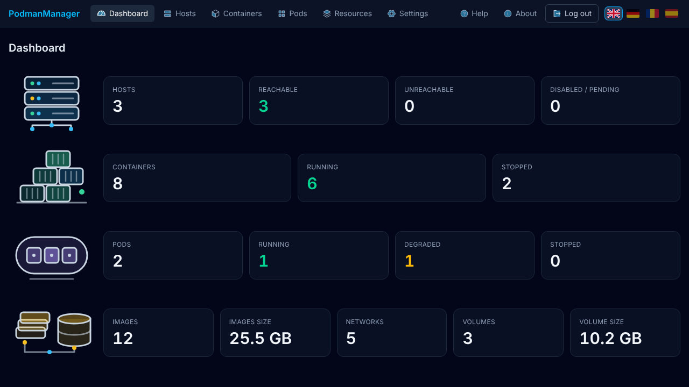
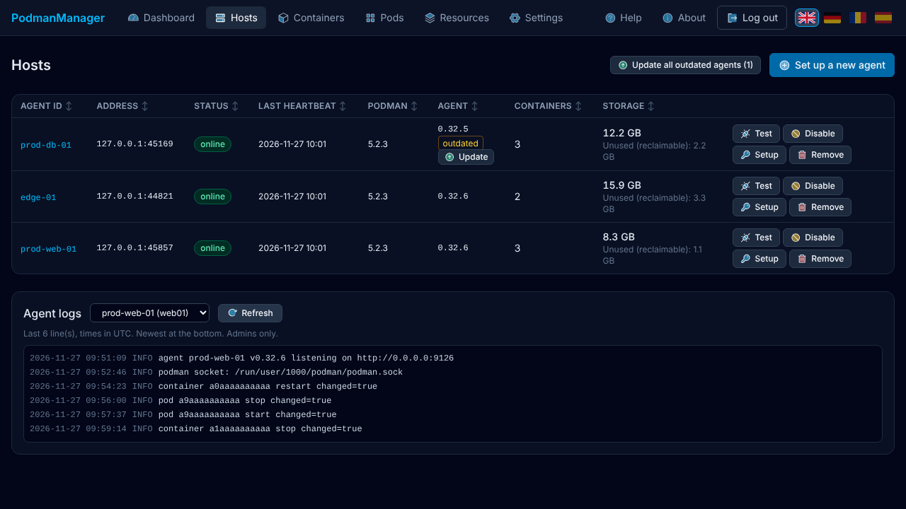
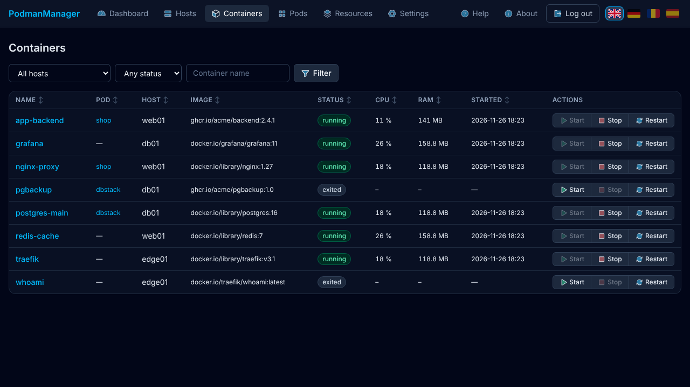
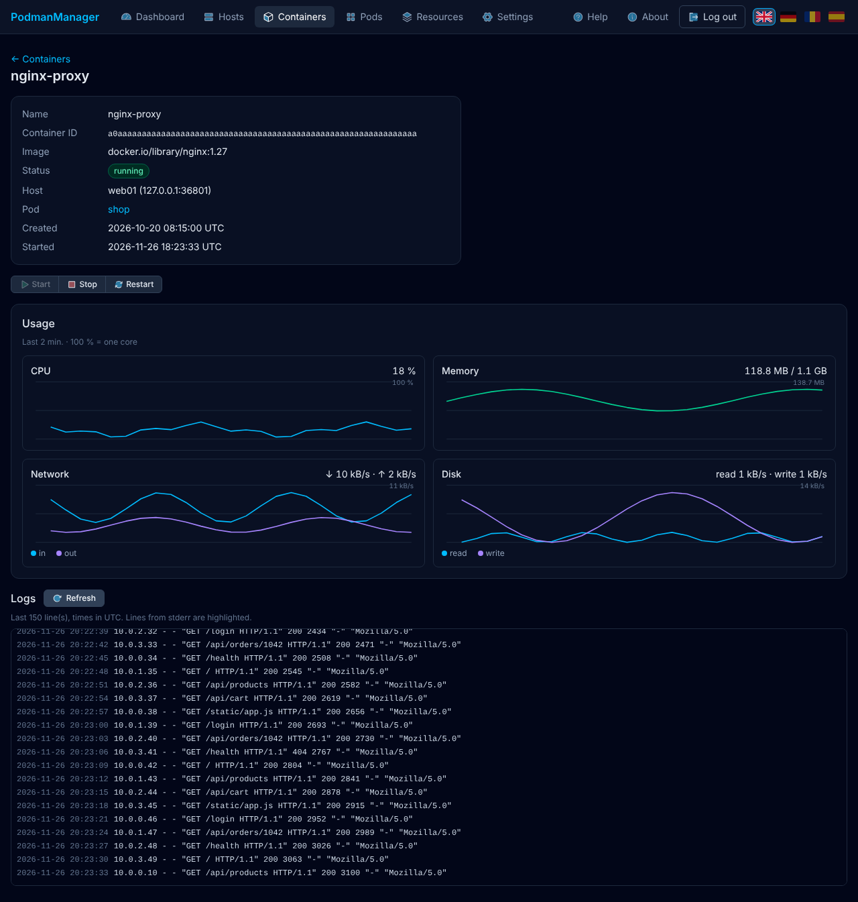
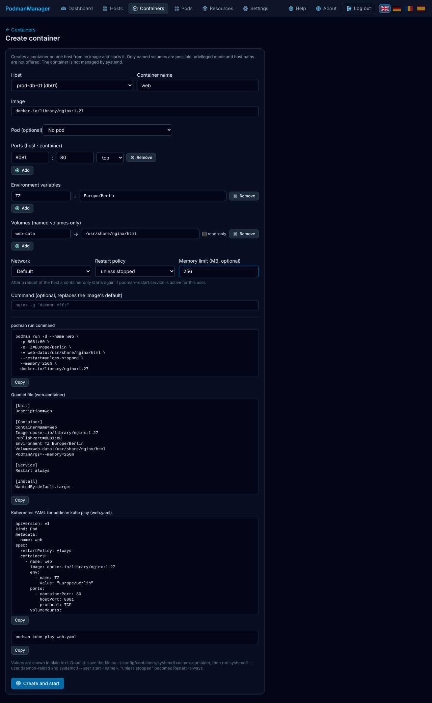
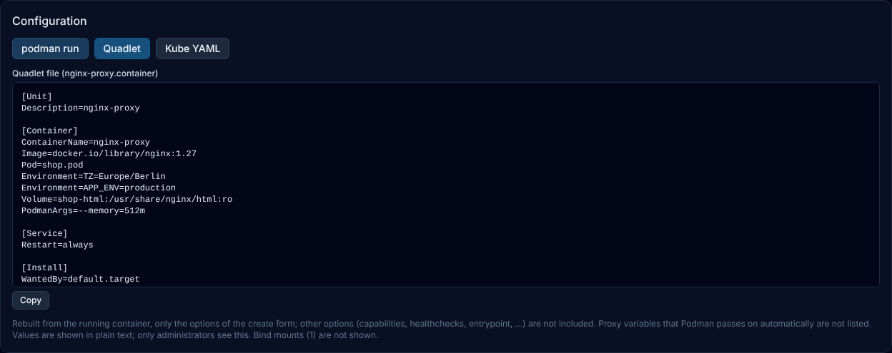
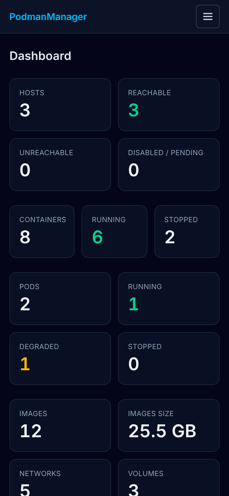
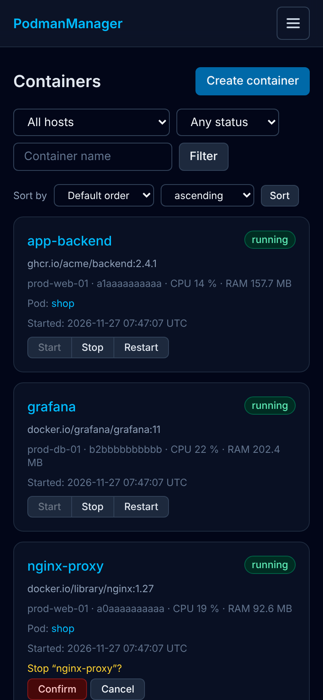
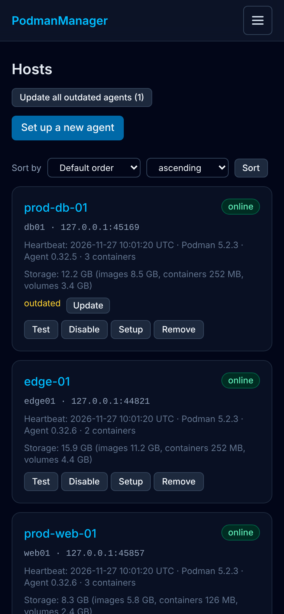

# PodmanManager

[](https://deepwiki.com/PetreHoffmann/PodmanManager)

**Eine Webseite, auf der Sie Ihre Anwendungen auf mehreren Servern sehen, starten, stoppen und neu starten – ohne sich auf den Servern anzumelden.**

Die Anwendungen laufen als **Container** (kleine, abgeschottete Programmpakete). PodmanManager verwaltet Container, die mit [Podman](https://podman.io) betrieben werden, ohne Administrator-Rechte (rootless) und ohne Docker.

## Was kann PodmanManager?

- **Überblick:** Welche Server und Anwendungen gibt es, und läuft alles?
- **Steuern:** Anwendungen starten, stoppen und neu starten (mit Rückfrage).
- **Anlegen:** Administratoren legen Container und Pods an und bekommen den passenden `podman run`-Befehl, die Quadlet-Datei und das Kubernetes-YAML zum Kopieren; dieselben Texte gibt es für vorhandene Container.
- **Nachlesen:** Meldungen (Logs) einer Anwendung lesen und sehen, wie stark sie Prozessor, Arbeitsspeicher, Netzwerk und Festplatte nutzt.
- **Aufräumen:** Programmpakete (Images), Netzwerke und Datenspeicher (Volumes) auf den Servern ansehen; Administratoren können Unbenutztes löschen.
- **Für alle Geräte:** Die Oberfläche gibt es auf Deutsch, Englisch, Rumänisch und Spanisch und passt sich dem Handy an.

PodmanManager **ändert keine bestehenden Container**. Administratoren können neue Container und leere Pods anlegen (nur benannte Volumes, kein privilegierter Modus, keine Host-Pfade). Das hält es einfach und sicher.

## So funktioniert es

```
Ihr Browser ── Master (die Webseite) ── Agent (ein kleines Programm je Server) ── Podman
```

- Der **Master** ist die Webseite. Es gibt ihn einmal.
- Auf **jedem Server**, den Sie verwalten wollen, läuft ein **Agent**. Er führt nur aus, was der Master ihm sagt, und kennt nichts anderes als den Podman seines Benutzers.

Beide sind fertige Container-Images auf Docker Hub: [Master](https://hub.docker.com/r/petrecalinoiu/podmanmanager-master) und [Agent](https://hub.docker.com/r/petrecalinoiu/podmanmanager-agent) (Apache-2.0).

## Bilder

| Dashboard | Hosts (Server) |
|---|---|
|  |  |
| **Container** | **Details mit Auslastung und Logs** |
|  |  |
| **Container erstellen (mit Vorschau)** | **Konfiguration als Quadlet** |
|  |  |

Auf dem Handy:

<p>
  
  
  
</p>

Die Bilder zeigen Beispieldaten. Weitere Bilder finden Sie im [Benutzerhandbuch](docs/benutzerhandbuch.md).

## Schnellstart in drei Schritten

**Was Sie brauchen:** einen Linux-Server mit Podman (Version 4.4 oder neuer, rootless), auf dem der Master laufen soll, und einen oder mehrere Server, die Sie verwalten wollen (dort ebenfalls Podman). Alle Befehle führen Sie als **normaler Benutzer** aus, nicht als root.

**Schritt 1: Master starten**

```bash
# Schlüssel für die gespeicherten Zugangsdaten, einmal anlegen und nie ändern (sichern!)
openssl rand -base64 32 | tr -d '\n' | podman secret create podmanmanager-key -

podman run -d --name podmanmanager-master --restart=always \
  -p 8080:8080 -v pm-data:/data \
  --secret podmanmanager-key,type=env,target=MASTER_SECRET_KEY \
  docker.io/petrecalinoiu/podmanmanager-master:latest
```

**Schritt 2: Im Browser einrichten**

1. `http://<server>:8080` öffnen und ein **Administrator-Passwort** festlegen.
2. Unter **Hosts** auf **Neuen Agent einrichten** gehen, die Adresse des Servers (`http://<server-ip>:9126`) und einen Namen (Agent-ID) eintragen.
3. Der Master zeigt nun die Befehle für diesen Server an (Reiter **podman run** oder **Quadlet**).

**Schritt 3: Agent auf dem Server starten**

Den Befehl aus dem Reiter **podman run** auf dem zu verwaltenden Server ausführen. Danach erscheint der Server im Master als **online**. Für den Dauerbetrieb nutzen Sie stattdessen die Quadlet-Datei aus dem Master.

**Wichtig:**

- PodmanManager nutzt **kein HTTPS**. Betreiben Sie es nur in einem abgeschotteten Netz, und öffnen Sie den Agent-Port `9126` nur für die Adresse des Masters (siehe [Sicherheit](docs/security.md)).
- Die ausführliche Anleitung mit allen Möglichkeiten steht in [Deployment](deployment/README.md) und [Agent-Installation](docs/installation-agent.md). Den Master ohne Container zu betreiben, beschreibt die [Master-Installation](docs/installation-master.md).

## Weitere Funktionen

Alles Folgende ist optional (die meisten Einstellungen finden Sie im Master unter **Einstellungen**):

- **Anmeldung** mit dem Firmenkonto per LDAP/Active Directory oder **SSO** (SAML 2.0, zum Beispiel ADFS, Entra ID, Okta, Keycloak) – siehe [SSO](docs/sso.md).
- **Gruppen:** Benutzer sehen nur die Server ihrer Gruppe; bestimmte Container lassen sich für sie ausblenden.
- **Zweiter Faktor (TOTP) und Passkeys** für das lokale Konto.
- **Aktualisieren per Knopfdruck:** Der Master meldet veraltete Agents und aktualisiert sie auf Wunsch, auch alle auf einmal.
- **Protokoll** der Aktionen (Audit-Log), **Sicherung** und Wiederherstellung der Master-Datenbank, eigenes Logo und eigener Name in der Navigationsleiste.

## Dokumentation

| | |
|---|---|
| [Benutzerhandbuch](docs/benutzerhandbuch.md) | Für Benutzer ohne Administrator-Rechte, mit Bildern |
| [Master-Installation](docs/installation-master.md) | Master einrichten und konfigurieren |
| [Agent-Installation](docs/installation-agent.md) | Agent auf einem Server einrichten |
| [Deployment (Schritt für Schritt)](deployment/README.md) | `podman run` und Quadlet für Master und Agent |
| [Quadlets](deployment/quadlet/README.md) | Dauerbetrieb mit systemd, gemeinsames Netzwerk, Updates |
| [Sicherheit](docs/security.md) | Was zu beachten ist, Firewall, Tokens |
| [Fehlersuche](docs/troubleshooting.md) | Häufige Fehler und ihre Lösung |
| [SSO mit SAML 2.0](docs/sso.md) | Anmeldung über das Firmenkonto |
| [Architektur](docs/architecture.md) | Aufbau und Entscheidungen (für Entwickler) |
| [API](docs/api.md) | Schnittstelle des Agents (für Entwickler) |

## Entwicklung & Tests

```bash
npm install
npm test -w apps/agent -w apps/master                 # Unit-/Komponententests
npm run build -w apps/master && node --import tsx integration/e2e.mts   # E2E (benötigt playwright)
```

Die Integrationstests gegen einen echten Podman-Socket (`apps/agent/test/integration.test.ts`) laufen nur, wenn ein rootless Socket vorhanden ist, und werden sonst übersprungen. Der E2E-Test verwendet nachgebaute Podman-Sockets.

## Lizenz

Apache License 2.0 – siehe [LICENSE](LICENSE) und [NOTICE](NOTICE). Kostenlose Nutzung, auch kommerziell. Bei Weitergabe müssen der Urheberhinweis und die `NOTICE`-Datei erhalten bleiben, und geänderte Dateien müssen einen auffälligen Hinweis auf die Änderung tragen.

Copyright 2026 Petre Hoffmann
