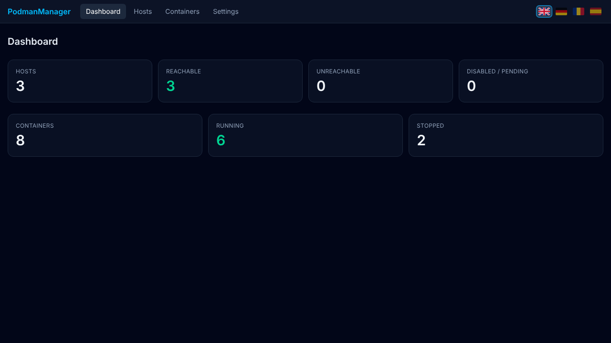
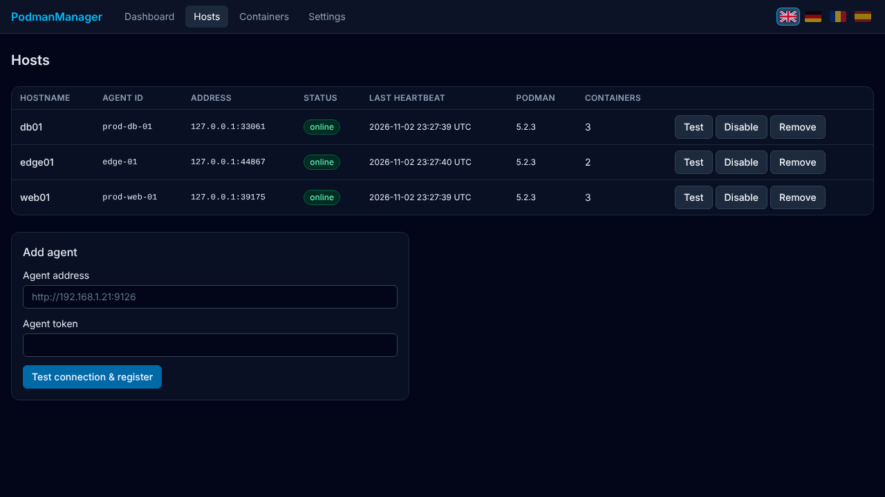
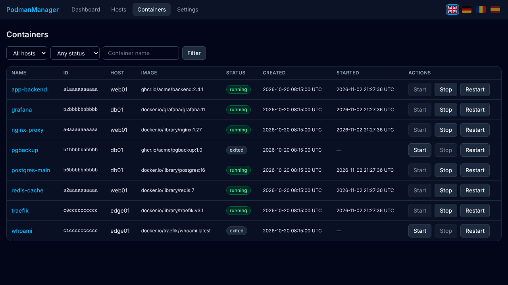
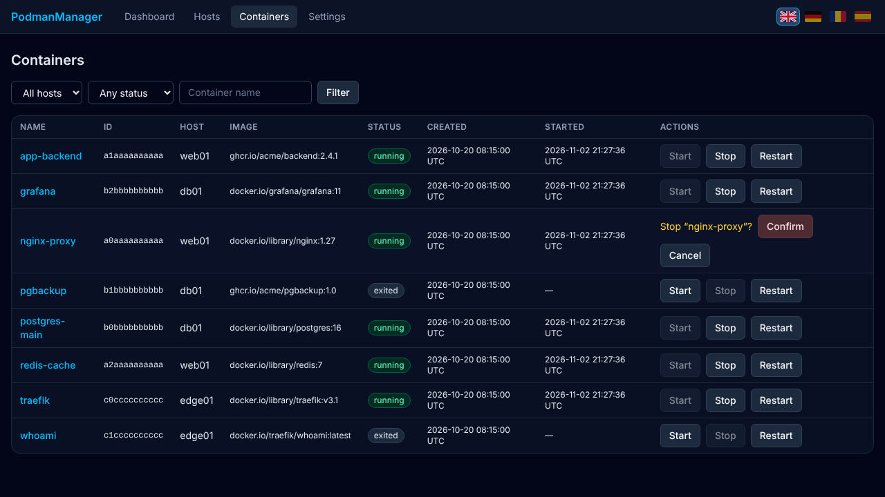
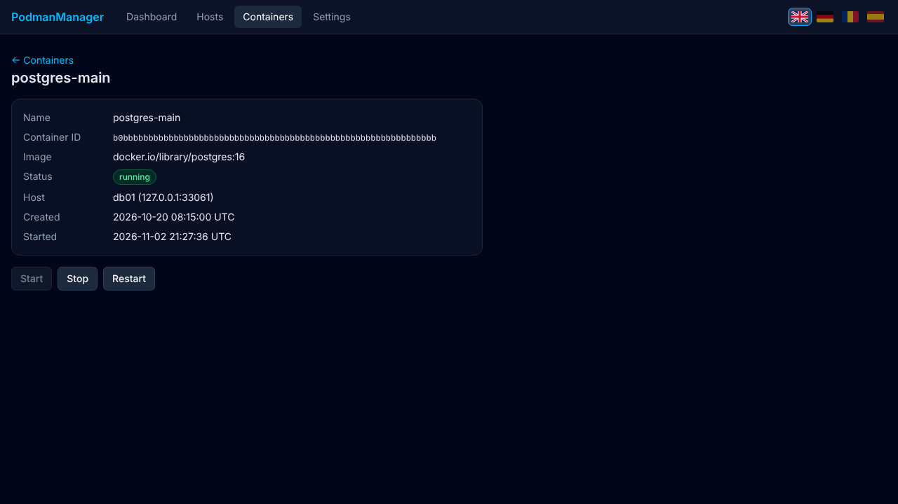
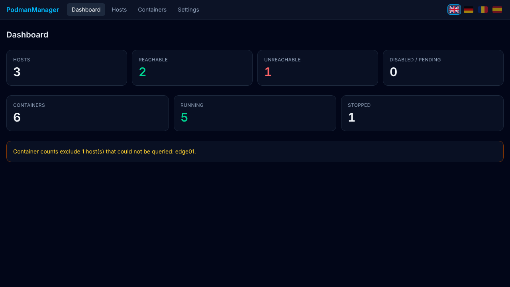
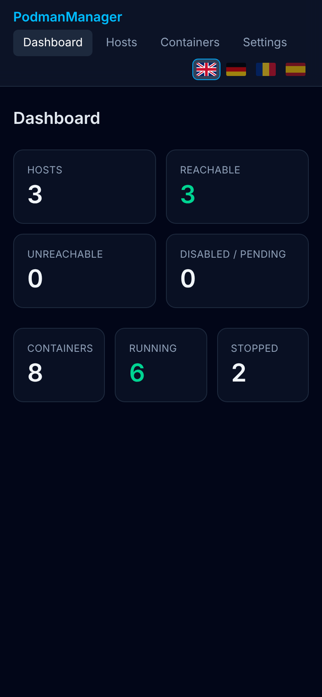
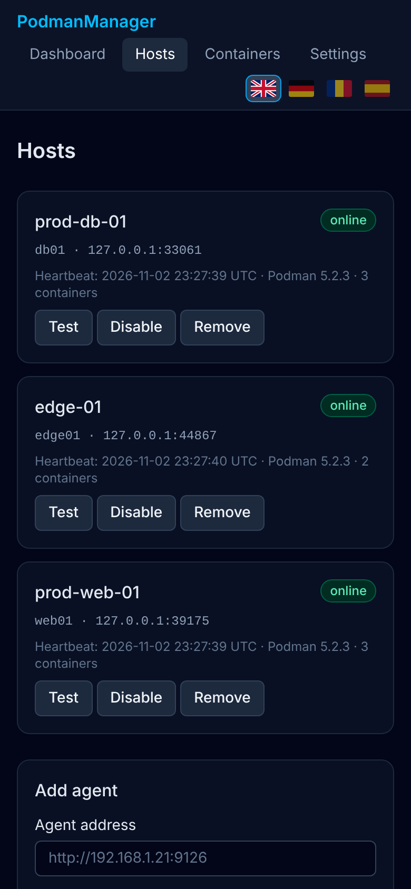
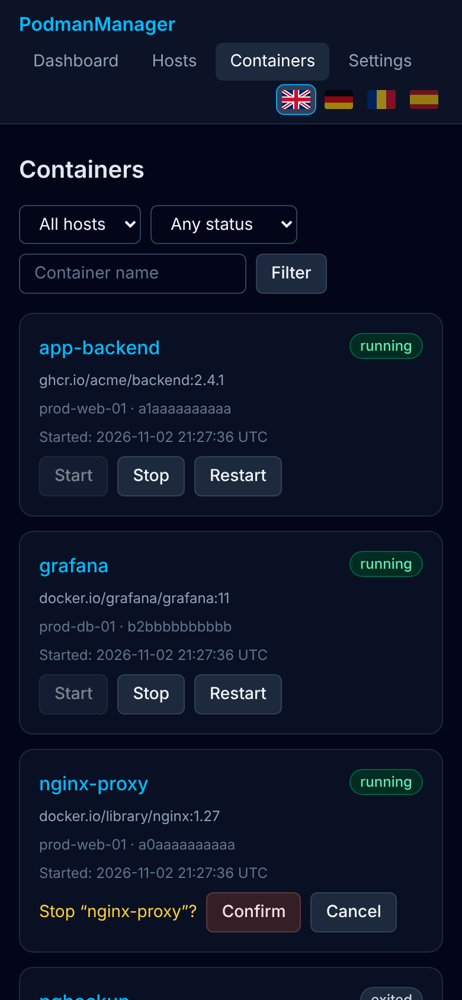

# PodmanManager

Schlanke zentrale Verwaltung von **rootless Podman**-Containern auf mehreren Linux-Hosts.
Funktionsumfang bewusst begrenzt: Container **anzeigen, starten, stoppen, neustarten**.

- **Master** (`apps/master`): Next.js-Weboberfläche, HTTP `:8080`, SQLite.
- **Agent** (`apps/agent`): eigenständiger Node.js-Prozess pro Host, HTTP `:9126`, spricht ausschließlich mit dem lokalen Podman-Unix-Socket des eigenen Benutzers. Keine Laufzeit-Abhängigkeiten.

```
Browser ── HTTP :8080 ── Master ── HTTP :9126 (Bearer-Token) ── Agent ── Unix-Socket ── Podman (rootless)
```

Die Oberfläche ist in Englisch, Deutsch, Rumänisch und Spanisch verfügbar (Flaggen-Auswahl oben rechts; Standard aus `Accept-Language`, danach per Cookie gemerkt). Die automatische Browser-Übersetzung ist per `translate="no"` und `<meta name="google" content="notranslate">` unterbunden.

Kein Docker, kein Compose, kein HTTPS/TLS, kein Root. **Nur in einem abgeschotteten Netz betreiben** (siehe [Sicherheit](docs/security.md)).

## Screenshots

**Desktop**

| Dashboard | Hosts |
|---|---|
|  |  |
| **Container** | **Stop mit Bestätigung** |
|  |  |
| **Container-Details** | **Host nicht erreichbar** (wird separat ausgewiesen) |
|  |  |

**Smartphone** (Kartenansicht statt Tabellen)

<p>
  
  
  
</p>

Die Screenshots zeigen Testdaten (nachgebaute Podman-Sockets). Die Oberfläche gibt es in Englisch, Deutsch, Rumänisch und Spanisch (Flaggen oben rechts).

## Schnellstart

Voraussetzungen: Linux, Node.js ≥ 22.13, auf Agent-Hosts rootless Podman + systemd.

```bash
# 1. Agent auf jedem Podman-Host (als normaler Benutzer, nicht root)
git clone <repo> && cd podmanmanager
deployment/agent/install.sh host-1        # gibt einmalig den Agent-Token aus

# 2. Master (siehe docs/installation-master.md)
npm ci && npm run build -w apps/master
MASTER_SECRET_KEY=$(openssl rand -base64 32) deployment/master/start.sh

# 3. http://<master>:8080 öffnen → Admin-Passwort setzen → Hosts → Agent hinzufügen
```

## Docker-Images

Fertige Images (Apache-2.0) liegen öffentlich auf Docker Hub: [`petrecalinoiu/podmanmanager-master`](https://hub.docker.com/r/petrecalinoiu/podmanmanager-master) und [`petrecalinoiu/podmanmanager-agent`](https://hub.docker.com/r/petrecalinoiu/podmanmanager-agent). Tags: `0.1.1`, `latest` (und `sha-<commit>`); sie werden bei jedem Git-Tag `v*` automatisch gebaut. Die Container-Starts sind bisher nicht auf echten Hosts getestet.

**Master**

```bash
docker run -d --name podmanmanager-master -p 8080:8080 \
  -v pm-data:/data \
  -e MASTER_SECRET_KEY="<32 Byte, base64: openssl rand -base64 32>" \
  petrecalinoiu/podmanmanager-master:0.1.1
```

`MASTER_SECRET_KEY` einmal festlegen und bei jedem Start wieder verwenden – mit einem neuen Schlüssel sind die gespeicherten Agent-Tokens unlesbar. Die Datenbank liegt im Volume `/data`.

**Agent** (empfohlen bleibt die native Installation mit `deployment/agent/install.sh`; als Container braucht der Agent den gemounteten Rootless-Socket und muss mit der UID des Podman-Benutzers laufen, er verweigert Root)

```bash
podman run --rm petrecalinoiu/podmanmanager-agent:0.1.1 node dist/index.js --generate-token   # Token + Hash
podman run -d --name pm-agent --user $(id -u) --userns=keep-id -p 9126:9126 \
  -v $XDG_RUNTIME_DIR/podman/podman.sock:/run/podman/podman.sock \
  -e AGENT_ID=host-1 -e AGENT_TOKEN_HASH=<hash> \
  docker.io/petrecalinoiu/podmanmanager-agent:0.1.1
```

Den Token im Master unter *Hosts* eintragen; Port 9126 nur für die Master-IP freigeben (siehe [Sicherheit](docs/security.md)).

## Dokumentation

| | |
|---|---|
| [Architektur](docs/architecture.md) | Komponenten, Datenfluss, Entscheidungen |
| [Master-Installation](docs/installation-master.md) | Build, Konfiguration, systemd, Datenbank |
| [Agent-Installation](docs/installation-agent.md) | install.sh, User-Service, Lingering, Podman-Socket |
| [API](docs/api.md) | Agent-REST-API, Fehlercodes |
| [Sicherheit](docs/security.md) | Bedrohungsmodell, Tokens, Firewall |
| [Troubleshooting](docs/troubleshooting.md) | Häufige Fehler |

## Entwicklung & Tests

```bash
npm install
npm test -w apps/agent -w apps/master                 # Unit-/Komponententests
npm run build -w apps/master && node --import tsx integration/e2e.mts   # E2E (benötigt playwright)
```

Die Integrationstests gegen einen echten Podman-Socket (`apps/agent/test/integration.test.ts`) laufen nur, wenn ein rootless Socket vorhanden ist, und werden sonst übersprungen. Der E2E-Test verwendet nachgebaute Podman-Sockets.

## Lizenz

Apache License 2.0 – siehe [LICENSE](LICENSE) und [NOTICE](NOTICE). Kostenlose Nutzung, auch kommerziell. Bei Weitergabe müssen der Urheberhinweis und die `NOTICE`-Datei erhalten bleiben, und geänderte Dateien müssen einen auffälligen Hinweis auf die Änderung tragen.

Copyright 2026 Petre Hoffmann
