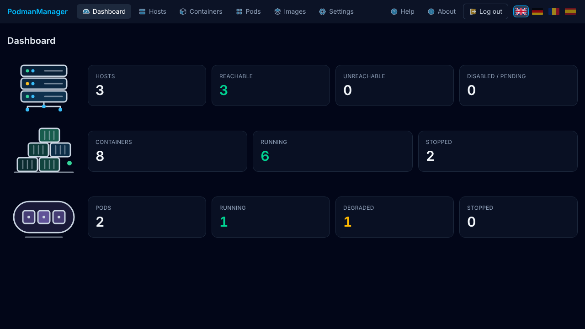
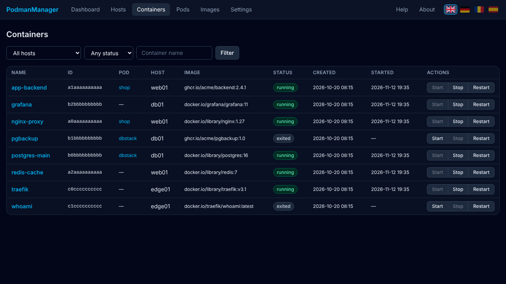

# PodmanManager Master

Central web UI for managing **rootless Podman** containers on multiple Linux hosts: view, start, stop and restart containers. Part of [PodmanManager](https://github.com/PetreHoffmann/PodmanManager) (Apache-2.0).

The Master talks over HTTP to lightweight **PodmanManager Agents** (`petrecalinoiu/podmanmanager-agent`) installed on each host. UI languages: English, German, Romanian, Spanish.




## Quick start

```bash
docker run -d --name podmanmanager-master -p 8080:8080 \
  -v pm-data:/data \
  -e MASTER_SECRET_KEY="$(openssl rand -base64 32)" \
  petrecalinoiu/podmanmanager-master:latest
```

Open `http://<host>:8080`, set the admin password (do this right away, the first visitor can set it), then add agents under **Hosts**.

**Keep `MASTER_SECRET_KEY` and reuse it on every start** — it encrypts the stored agent tokens; a new key makes them unreadable.

## Configuration

| Variable | Default | |
|---|---|---|
| `MASTER_SECRET_KEY` | required | 32 bytes, base64 or hex |
| `PORT` / `HOSTNAME` | `8080` / `0.0.0.0` | listen port / address |
| `DATABASE_URL` | `file:/data/master.db` | SQLite file (mount `/data`) |
| `HEARTBEAT_INTERVAL` | `30` | seconds between agent checks |
| `AGENT_TIMEOUT` | `5` | seconds |
| `HEARTBEAT_FAILURES` | `3` | failed checks until "offline" |

## Security

HTTP only (no TLS) by design: run it in an isolated network and restrict port 8080 with a firewall. See [docs/security.md](https://github.com/PetreHoffmann/PodmanManager/blob/main/docs/security.md) (German).

## Links

- Source, docs, issues: https://github.com/PetreHoffmann/PodmanManager
- Agent image: https://hub.docker.com/r/petrecalinoiu/podmanmanager-agent
