# PodmanManager – Benutzerhandbuch

**Für alle, die Anwendungen auf den Servern Ihres Unternehmens im Blick behalten oder neu starten müssen – ohne technische Vorkenntnisse und ohne Administrator-Rechte.**

> Die Bilder in diesem Handbuch zeigen Beispieldaten. Bei Ihnen heißen Rechner und Anwendungen anders.

## Inhalt

1. [Wofür gibt es PodmanManager?](#1-wofür-gibt-es-podmanmanager)
2. [Anmelden und Abmelden](#2-anmelden-und-abmelden)
3. [Die Oberfläche im Überblick](#3-die-oberfläche-im-überblick)
4. [Dashboard: der schnelle Überblick](#4-dashboard-der-schnelle-überblick)
5. [Hosts: Ihre Rechner](#5-hosts-ihre-rechner)
6. [Container: Ihre Anwendungen](#6-container-ihre-anwendungen)
7. [Pods: zusammengehörende Anwendungen](#7-pods-zusammengehörende-anwendungen)
8. [Images: die Programmpakete](#8-images-die-programmpakete)
9. [Einstellungen, Über, Sprache](#9-einstellungen-über-sprache)
10. [Mit dem Smartphone](#10-mit-dem-smartphone)
11. [Was Sie nicht sehen und nicht ändern können](#11-was-sie-nicht-sehen-und-nicht-ändern-können)
12. [Wenn etwas nicht klappt](#12-wenn-etwas-nicht-klappt)
13. [Kleines Wörterbuch](#13-kleines-wörterbuch)
---

## 1. Wofür gibt es PodmanManager?

Ihr Unternehmen betreibt Anwendungen auf mehreren Rechnern (Servern). PodmanManager zeigt Ihnen auf **einer Webseite**, ob diese Anwendungen laufen, und erlaubt Ihnen, sie bei Bedarf **zu starten, zu stoppen oder neu zu starten** – ohne sich auf dem Server anzumelden.

Sie können damit:

- sehen, welche Rechner und Anwendungen es gibt und ob alles läuft,
- eine Anwendung starten, stoppen oder neu starten,
- nachlesen, was eine Anwendung zuletzt gemeldet hat (die sogenannten **Logs**),
- sehen, wie viel Speicherplatz die Anwendungen auf einem Rechner belegen,
- nachsehen, welche **Images** (Programmpakete) auf den Rechnern liegen und welche davon benutzt werden.

PodmanManager **löscht, ändert und legt keine Anwendungen an**. Für Sie gibt es nur Starten, Stoppen und Neustarten (und nur für die Rechner Ihrer Gruppe). Images können Sie nur ansehen; löschen dürfen sie nur Administratoren. Bedenken Sie aber, dass ein Stopp die Anwendung für alle Nutzer beendet. Mehr dazu in [Kapitel 6](#6-container-ihre-anwendungen) und [Kapitel 11](#11-was-sie-nicht-sehen-und-nicht-ändern-können).

## 2. Anmelden und Abmelden

**Anmelden**

1. Öffnen Sie die Adresse im Browser, die Ihnen Ihr Administrator genannt hat (zum Beispiel `http://master.firma.example:8080`).
2. Melden Sie sich an, auf **einem von zwei Wegen**:
   - **Mit Benutzername und Passwort:** Geben Sie Ihren **Benutzernamen** und Ihr **Passwort** ein und klicken Sie auf **Anmelden**. Es sind dieselben Zugangsdaten wie bei Ihrer normalen Anmeldung im Firmennetz.
   - **Mit SSO (Einmalanmeldung):** Klicken Sie auf **Mit SSO anmelden** (Ihr Unternehmen kann den Text geändert haben). Sie werden zur Anmeldung Ihres Unternehmens weitergeleitet und danach automatisch zurückgebracht. Sind Sie am Firmenrechner bereits angemeldet, geht das meist **ohne erneute Eingabe**.

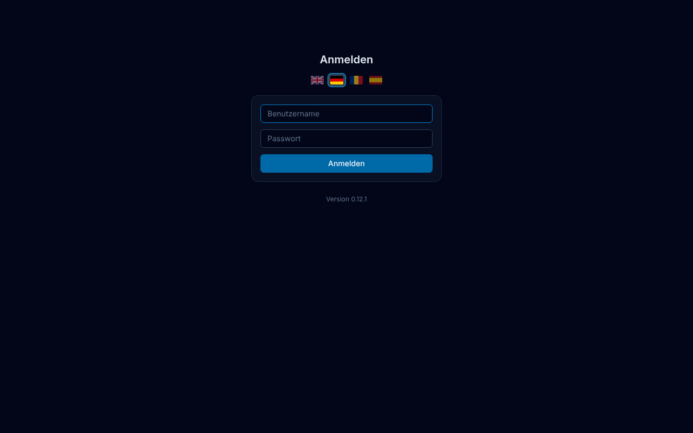

Der SSO-Knopf erscheint nur, wenn Ihr Administrator SSO eingerichtet hat. Welchen Weg Sie nutzen, ist egal; Sie sehen danach dieselben Rechner und Anwendungen, nämlich die Ihrer Gruppen.

Oben rechts können Sie schon hier die **Sprache** wählen (Flaggen).

Gut zu wissen:

- Nach **mehreren falschen Eingaben innerhalb einer Minute** erscheint „Zu viele Fehlversuche. Bitte in einer Minute erneut versuchen.“ Warten Sie kurz und versuchen Sie es noch einmal.
- Wenn „Benutzername oder Passwort ungültig“ erscheint, obwohl Sie sicher sind: Fragen Sie Ihren Administrator, ob Ihr Konto für PodmanManager freigeschaltet ist.
- Wenn Sie sich per **SSO** erfolgreich anmelden, aber eine Meldung wie „Ihr Konto gehört zu keiner Gruppe“ erscheint, ist Ihr Konto noch keiner Gruppe zugeordnet. Der Administrator muss das einrichten. Erscheint stattdessen eine Fehlerseite des Unternehmens, melden Sie dem Administrator die genaue Meldung und die Uhrzeit.
- Aus Sicherheitsgründen werden Sie nach **8 Stunden automatisch abgemeldet** und müssen sich neu anmelden.

**Abmelden**

Öffnen Sie **Einstellungen** und klicken Sie unten auf **Abmelden**. Das sollten Sie tun, wenn Sie einen Rechner mit anderen teilen.

**Hinweis bei SSO:** Das Abmelden beendet Ihre Sitzung in PodmanManager; Ihre Anmeldung im Firmennetz bleibt bestehen. Nach dem Abmelden verlangt PodmanManager beim nächsten Klick auf **Mit SSO anmelden**, dass Sie sich **erneut anmelden** (Benutzername und Passwort). Haben Sie einen Firmenrechner mit automatischer Windows-Anmeldung, kann das ohne Eingabe gehen, weil Ihr Windows-Konto die Anmeldung übernimmt. Auf einem fremden oder gemeinsam genutzten Rechner melden Sie sich daher zusätzlich vom Windows-Konto bzw. Firmennetz ab und schließen den Browser.

## 3. Die Oberfläche im Überblick

Oben sehen Sie die **Navigationsleiste**. Von dort erreichen Sie alle Bereiche:

| Eintrag | Was Sie dort finden |
|---|---|
| **Dashboard** | Zahlen auf einen Blick: wie viele Rechner, Anwendungen und Gruppen laufen |
| **Hosts** | Die Rechner, auf denen Ihre Anwendungen laufen, mit Zustand und Speicherplatz |
| **Container** | Alle einzelnen Anwendungen. Hier starten, stoppen, neu starten und Logs lesen |
| **Pods** | Anwendungen, die zusammengehören, als Gruppe |
| **Images** | Die Programmpakete auf den Rechnern, nur zum Ansehen |
| **Einstellungen** | Wer Sie sind, was Sie sehen dürfen, Abmelden |
| **Hilfe** | Öffnet die Projektseite im Internet (in englischer Sprache) |
| **Über** | Version von PodmanManager und ob eine neuere Version verfügbar ist |
| **Flaggen** | Sprache wechseln: Englisch, Deutsch, Rumänisch, Spanisch |

**Wichtig:** Sie sehen nur die Rechner, für die Ihre **Gruppe** freigegeben ist. Das steht auf jeder Seite oben, zum Beispiel: *„Sie sehen nur die Agents Ihrer Gruppen: Team A.“* Fehlt ein Rechner, den Sie erwarten, ist er nicht für Ihre Gruppe freigegeben (siehe [Kapitel 12](#12-wenn-etwas-nicht-klappt)).

**Aktualisierung:** Die Seiten aktualisieren sich **nicht von selbst**. Wenn Sie den aktuellen Stand sehen möchten, laden Sie die Seite neu (Taste **F5** oder das Neu-laden-Symbol im Browser). Nach einem Start, Stopp oder Neustart aktualisiert sich die Anzeige automatisch.

## 4. Dashboard: der schnelle Überblick

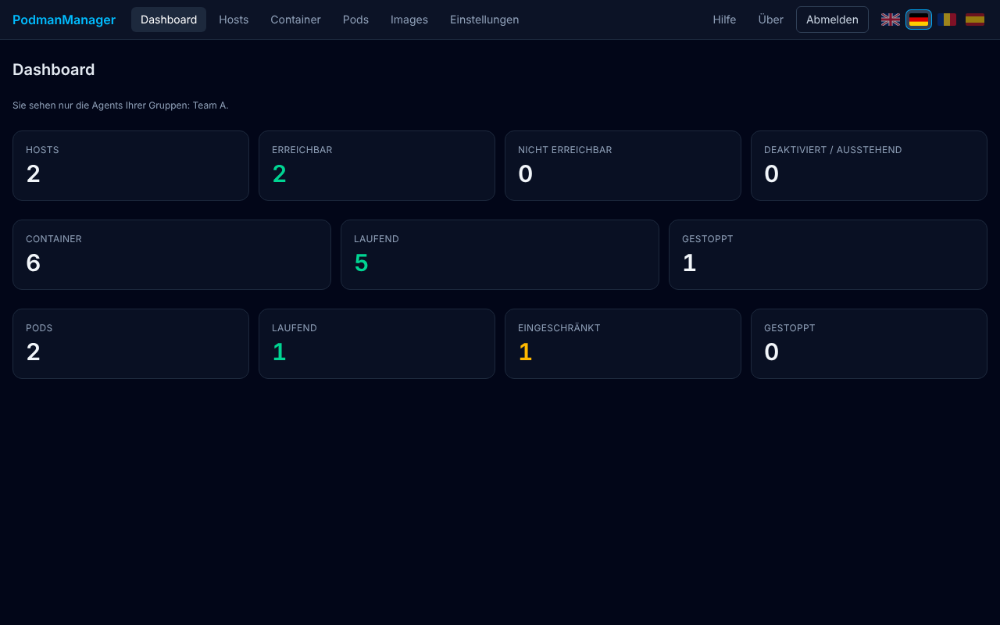

Das Dashboard besteht aus drei Reihen mit Zahlen:

- **Hosts:** wie viele Rechner Sie sehen, davon *erreichbar*, *nicht erreichbar* und *deaktiviert / ausstehend*.
- **Container:** wie viele Anwendungen es gibt, davon *laufend* und *gestoppt*.
- **Pods:** wie viele Gruppen es gibt, davon *laufend*, *eingeschränkt* (ein Teil läuft nicht) und *gestoppt*.

**Farben:** Grün bedeutet „in Ordnung“, Rot „Problem“, Orange „aufpassen“. Eine Zahl bei **Nicht erreichbar** ist ein Grund, bei Ihrem Administrator nachzufragen.

Erscheint ein orangefarbener Hinweis wie *„Die Container-Zahlen enthalten 1 Host(s) nicht, die nicht abgefragt werden konnten“*, war ein Rechner gerade nicht erreichbar. Seine Anwendungen sind dann in den Zahlen nicht enthalten.

## 5. Hosts: Ihre Rechner

Unter **Hosts** sehen Sie jeden Rechner, den Sie sehen dürfen, in einer Zeile:

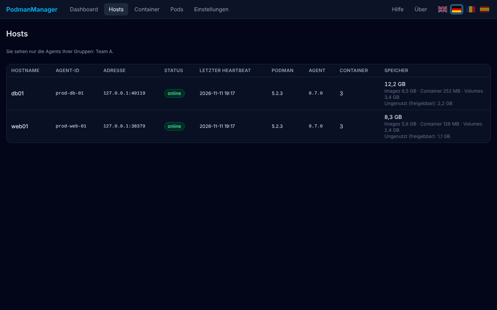

| Spalte | Bedeutung |
|---|---|
| **Hostname** | Name des Rechners |
| **Agent-ID** | Kennung des kleinen Hilfsprogramms auf dem Rechner (siehe [Wörterbuch](#13-kleines-wörterbuch)) |
| **Adresse** | Netzwerkadresse des Hilfsprogramms (für Sie meist uninteressant) |
| **Status** | **online** = alles in Ordnung, **eingeschränkt** = Rechner erreichbar, aber es gibt ein Problem mit der Anwendungs-Verwaltung, **offline** = nicht erreichbar, **deaktiviert** = vom Administrator abgeschaltet |
| **Letzter Heartbeat** | Wann der Rechner zuletzt geantwortet hat („Herzschlag“). Fahren Sie mit der Maus darüber, sehen Sie die genaue Zeit |
| **Podman / Agent** | Versionsnummern der Software (für Fragen an den Administrator hilfreich). Steht unter der Agent-Version **veraltet**, läuft auf dem Rechner eine ältere Version des Hilfsprogramms. Das beeinträchtigt Ihre Arbeit nicht; der Administrator kann es aktualisieren |
| **Container** | Anzahl der Anwendungen auf dem Rechner |
| **Speicher** | Wie viel Speicherplatz die Anwendungen belegen, aufgeteilt nach *Images* (Programmpakete), *Container* (laufende Anwendungen) und *Volumes* (gespeicherte Daten). „Ungenutzt“ ist der Teil, den man aufräumen könnte |

Als Benutzer können Sie hier **nichts ändern**, nur ansehen.

Sehen Sie in der Spalte **Speicher** statt Zahlen einen **orangefarbenen Text** oder nur einen Strich, kann der Rechner den Wert gerade nicht ermitteln. Das beeinträchtigt Ihre Anwendungen nicht. Melden Sie es Ihrem Administrator und geben Sie den angezeigten Text weiter.

## 6. Container: Ihre Anwendungen

Ein **Container** ist eine einzelne Anwendung (zum Beispiel ein Webserver oder eine Datenbank). Unter **Container** sehen Sie alle:

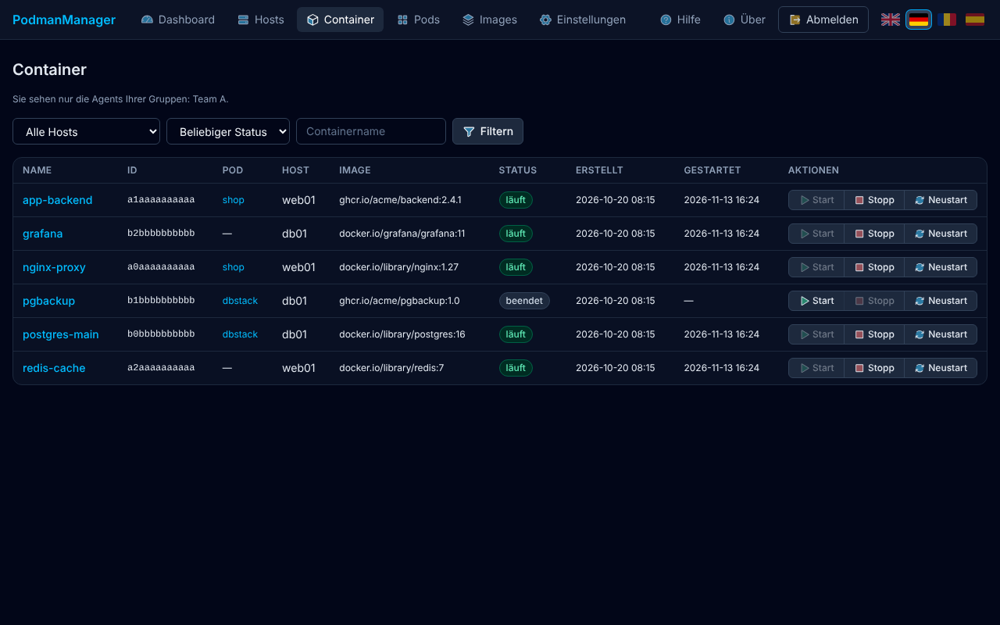

**Die Liste**

- **Name** – anklicken öffnet die Detailseite.
- **Pod** – gehört die Anwendung zu einer Gruppe, steht hier deren Name (anklicken öffnet die Gruppe). Ein Strich bedeutet: keine Gruppe.
- **Host** – auf welchem Rechner sie läuft.
- **Status** – **läuft** (grün) oder **beendet** (grau).
- **Erstellt / Gestartet** – wann die Anwendung angelegt und zuletzt gestartet wurde (Zeiten in UTC, siehe Hinweis bei den Logs).
- **Aktionen** – **Start**, **Stopp**, **Neustart**.

**Filtern:** Über der Liste können Sie nach **Host**, **Status** und **Containername** filtern. Wählen Sie etwas aus oder tippen Sie einen Namen (ein Teil genügt) und klicken Sie auf **Filtern**.

### Eine Anwendung starten, stoppen oder neu starten

- **Start** ist nur aktiv, wenn die Anwendung **nicht** läuft.
- **Stopp** ist nur aktiv, wenn sie **läuft**.
- **Neustart** geht immer.

**Stopp** und **Neustart** fragen zur Sicherheit nach:

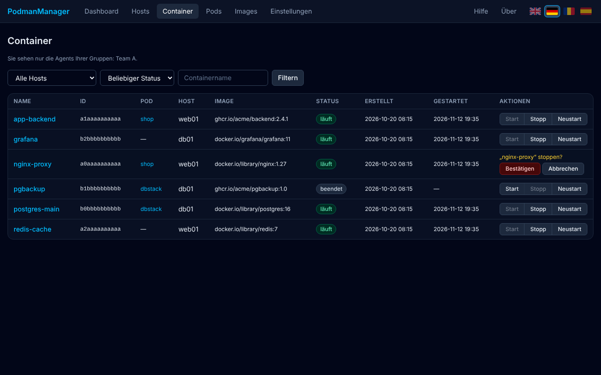

1. Klicken Sie auf **Stopp** (oder **Neustart**).
2. Es erscheint die Frage *„nginx-proxy“ stoppen?* Klicken Sie auf **Bestätigen** – oder auf **Abbrechen**, wenn Sie sich vertan haben.
3. Warten Sie einen Moment („Bitte warten …“). Danach meldet die Anwendung in Grün zum Beispiel *„Stopp erfolgreich: jetzt beendet“*. Klappt es nicht, erscheint eine **rote** Meldung mit dem Grund.

> **Bitte vorher überlegen:** Wer die Anwendung gerade nutzt, wird beim **Stoppen** getrennt und beim **Neustart** kurz unterbrochen. Stoppen Sie nur Anwendungen, für die Sie zuständig sind oder bei denen Sie dazu aufgefordert wurden.

Hinweis: Manche Anwendungen sind **für Sie ausgeblendet**, weil Ihr Administrator sie bewusst verborgen hat. Das ist kein Fehler.

### Die Detailseite einer Anwendung

Ein Klick auf den Namen öffnet die Detailseite:

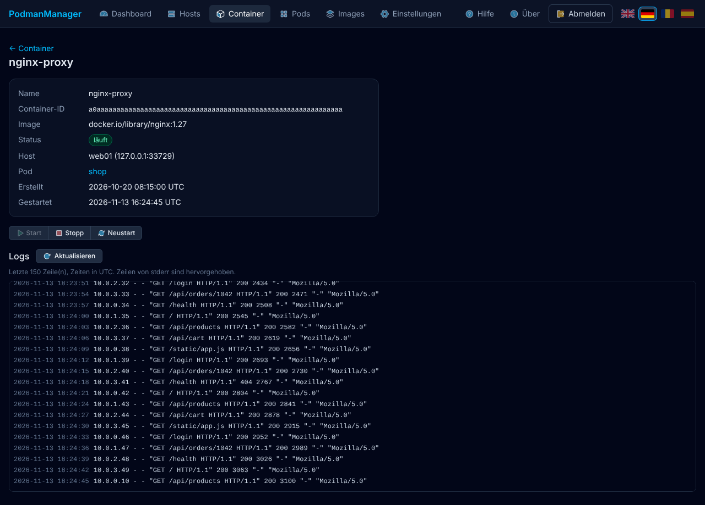

Oben sehen Sie Name, Programmpaket (**Image**), **Status**, Rechner (**Host**), eventuell die **Pod**-Gruppe und die Zeiten. Darunter stehen dieselben Knöpfe **Start**, **Stopp**, **Neustart**.

**Logs lesen:** Ein Klick auf **Logs anzeigen** lädt die **letzten 150 Zeilen**, die die Anwendung geschrieben hat – eine Art Tagebuch der Anwendung. Neueste Zeilen stehen unten. **Aktualisieren** lädt neu. Zeilen in **Orange** sind Fehlermeldungen.

- Die Uhrzeiten in den Logs sind in **UTC** (Weltzeit). In Deutschland sind Sie im Winter eine Stunde, im Sommer zwei Stunden später.
- Logs ändern nichts. Sie zeigen nur an.
- **Vorsicht:** Logs können vertrauliche Angaben enthalten (zum Beispiel Namen oder interne Adressen). Geben Sie Auszüge nur weiter, wenn das erlaubt ist.

## 7. Pods: zusammengehörende Anwendungen

Ein **Pod** fasst mehrere Anwendungen zusammen, die nur gemeinsam sinnvoll sind, zum Beispiel ein Webshop aus Webserver und Programm. Unter **Pods** sehen Sie sie in einer Liste:

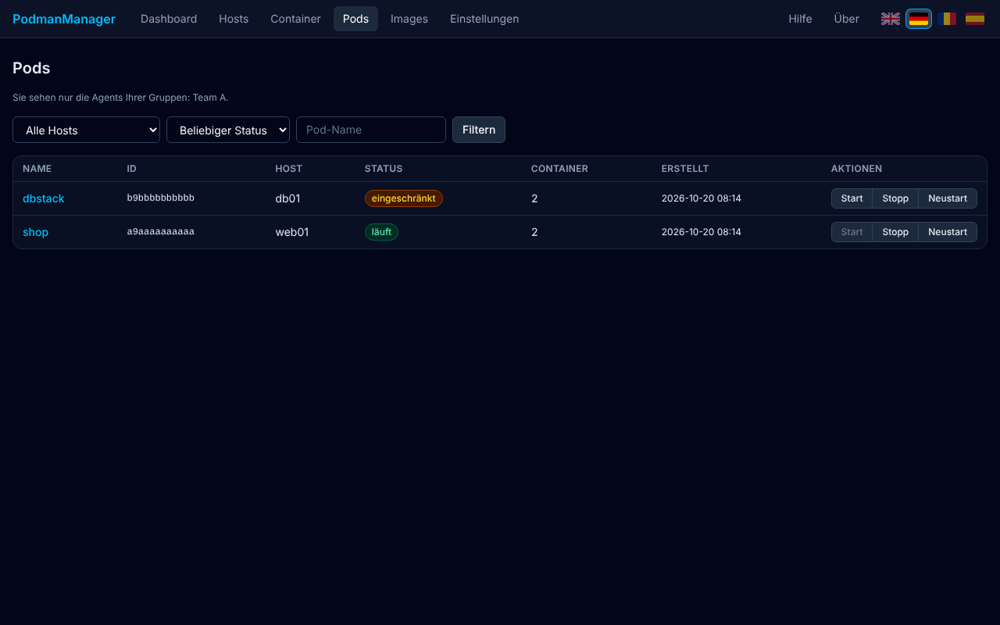

- **Status:** **läuft** (alle Anwendungen laufen), **eingeschränkt** (ein Teil läuft nicht), **beendet** (nichts läuft).
- **Aktionen:** **Start**, **Stopp** und **Neustart** wirken auf **alle Anwendungen der Gruppe zugleich**. Bei einem *eingeschränkten* Pod sind sowohl Start (startet die fehlenden) als auch Stopp möglich. Auch hier gibt es die Rückfrage bei Stopp und Neustart.
- Filtern geht wie bei den Containern.

Ein Klick auf den Namen öffnet die **Detailseite**:

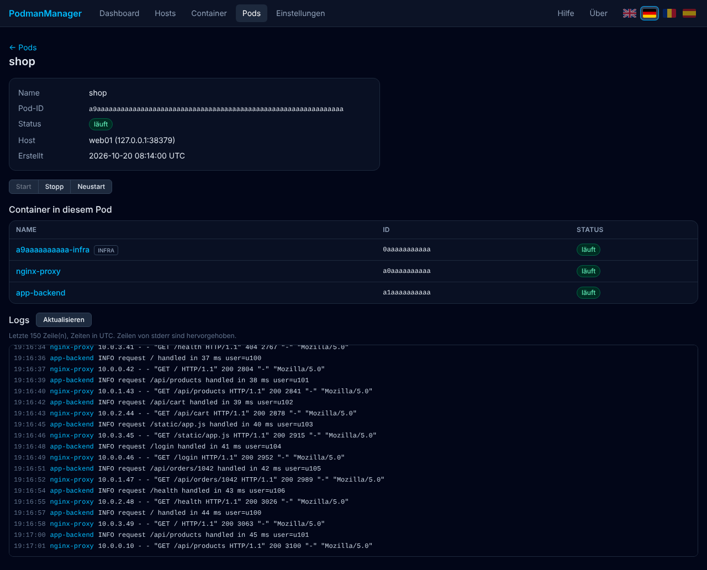

Dort sehen Sie die **enthaltenen Anwendungen** mit ihrem Zustand. Der Eintrag mit der Markierung **INFRA** ist ein technischer Hilfsbaustein des Pods, den Sie ignorieren können. Mit **Logs anzeigen** lesen Sie die **gemischten Logs aller Anwendungen** der Gruppe. Vor jeder Zeile steht der Name der Anwendung, von der sie stammt.

## 8. Images: die Programmpakete

Ein **Image** ist das „Programmpaket“, aus dem ein Container gestartet wird. Unter **Images** sehen Sie, welche Pakete auf den Rechnern Ihrer Gruppe liegen:

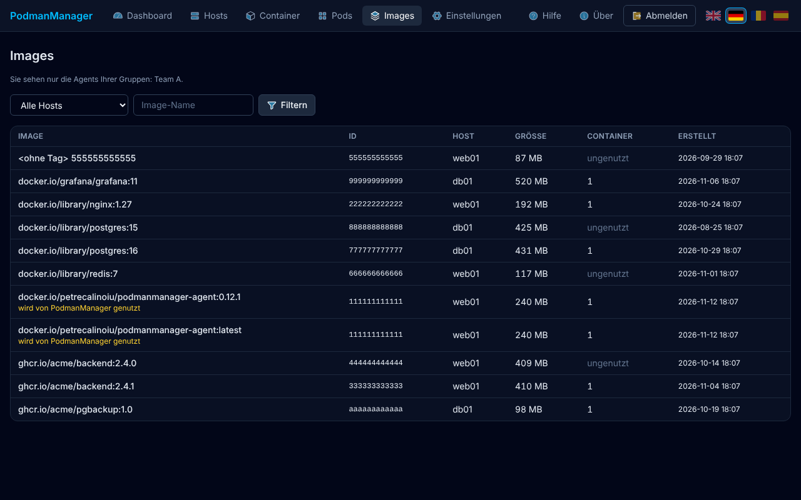

| Spalte | Bedeutung |
|---|---|
| **Image** | Name und Version des Pakets, zum Beispiel `nginx:1.27`. Ein Paket mit mehreren Namen steht in mehreren Zeilen. Pakete ohne Namen heißen **„ohne Tag“** (meist Reste einer Aktualisierung) |
| **ID** | Kurzkennung des Pakets |
| **Host** | Auf welchem Rechner es liegt |
| **Größe** | Belegter Speicherplatz |
| **Container** | Wie viele Anwendungen dieses Paket gerade benutzen. **ungenutzt** heißt: keine |
| **Erstellt** | Wann das Paket gebaut wurde |

Mit dem Filter oben grenzen Sie nach **Host** oder **Image-Name** ein. Die Markierung **wird von PodmanManager genutzt** bedeutet: Dieses Paket gehört zu PodmanManager selbst.

Als Benutzer können Sie Images **nur ansehen**. Löschen und Aufräumen sind Administratoren vorbehalten. Sehen Sie viele ungenutzte Pakete oder fehlt Speicherplatz, informieren Sie Ihren Administrator.

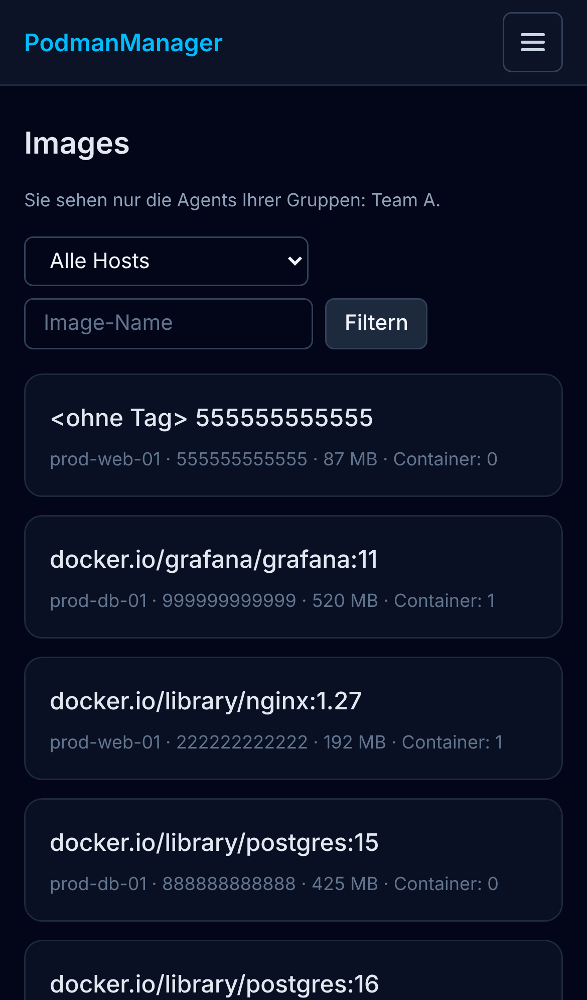

## 9. Einstellungen, Über, Sprache

**Einstellungen**

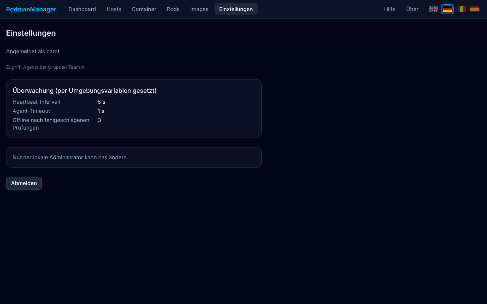

Hier (Registerkarte **Allgemein**) sehen Sie, als wer Sie angemeldet sind, **auf welche Rechner Sie zugreifen dürfen** (Ihre Gruppen) und wie oft PodmanManager die Rechner prüft. Ändern können Sie als Benutzer hier nichts, das ist dem Administrator vorbehalten („Nur der lokale Administrator kann das ändern“). Ihr **Passwort** ändern Sie nicht hier, sondern wie gewohnt im Firmennetz. Unten finden Sie **Abmelden**.

**Über**

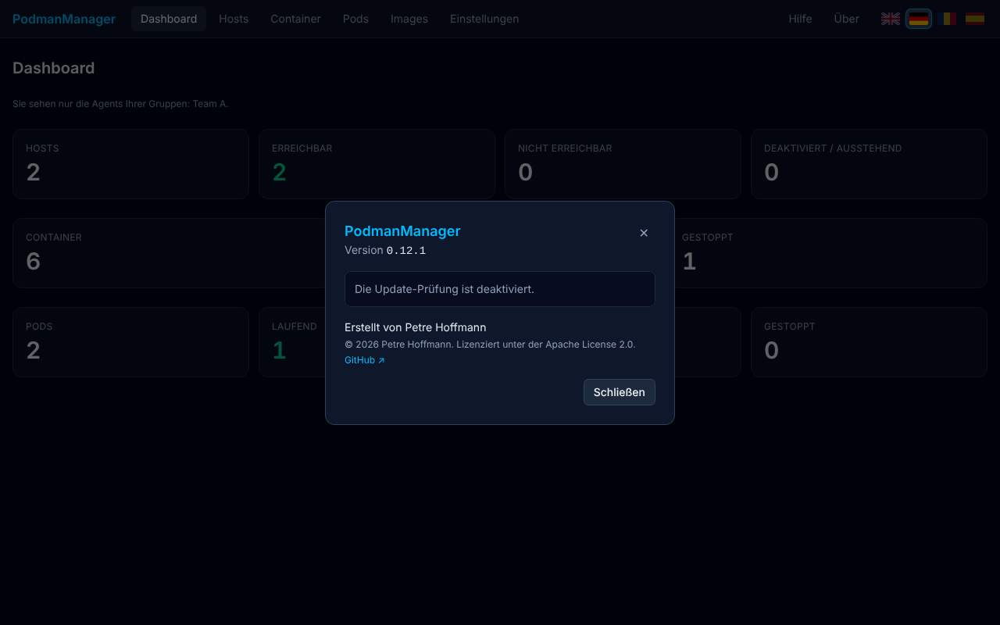

Zeigt die **Versionsnummer** von PodmanManager und – falls aktiviert – ob eine neuere Version verfügbar ist. Hilfreich, wenn Sie dem Administrator ein Problem melden. Das Aktualisieren übernimmt der Administrator; für Sie gibt es dort keinen Knopf.

**Sprache**

Mit den **Flaggen** oben rechts wechseln Sie zwischen Englisch, Deutsch, Rumänisch und Spanisch. Ihre Wahl wird im Browser gemerkt. Eine automatische Übersetzung durch den Browser ist ausgeschaltet, damit Fachbegriffe korrekt bleiben.

## 10. Mit dem Smartphone

Auf dem Handy passt sich die Seite an: Tabellen werden zu **Karten**, und die Navigationsleiste verbirgt sich hinter einem **Menü-Knopf** mit drei Strichen oben rechts.

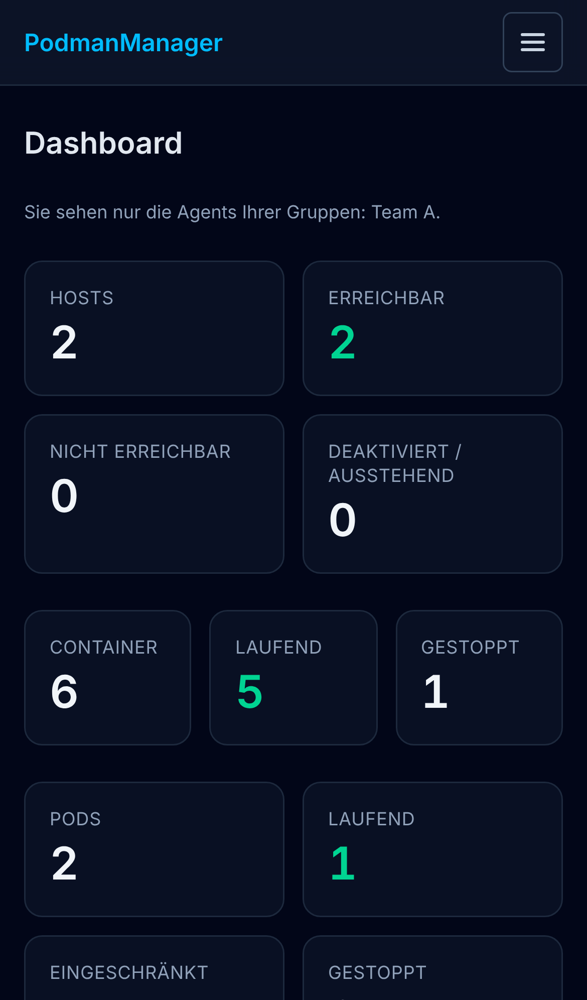

1. Tippen Sie auf den **Menü-Knopf**. Die Liste mit Dashboard, Hosts, Container, Pods, Images, Einstellungen, Hilfe, Über und den Sprach-Flaggen klappt auf.
2. Tippen Sie auf einen Eintrag. Das Menü schließt sich von selbst. Ein weiterer Tipp auf den Knopf (jetzt ein **X**) schließt es ebenfalls.

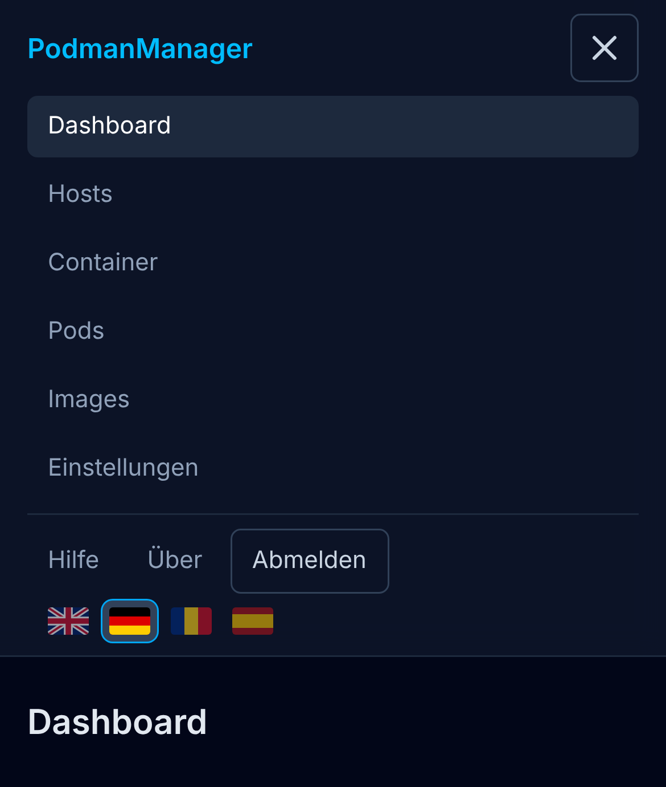

Die Knöpfe zum Starten, Stoppen und Neustarten finden Sie in jeder Karte:

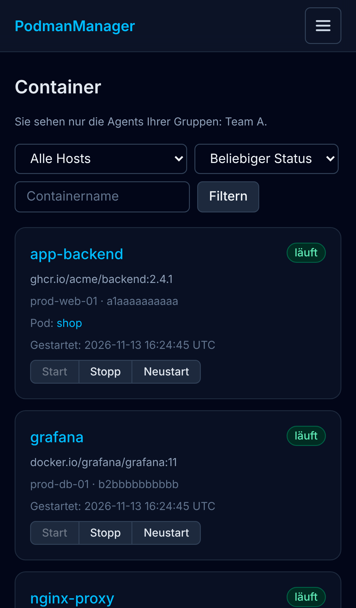

## 11. Was Sie nicht sehen und nicht ändern können

Das ist **Absicht** und dient der Sicherheit:

- Sie sehen nur Rechner Ihrer **Gruppen**.
- Einzelne Anwendungen können für Sie **ausgeblendet** sein. Pods, in denen eine ausgeblendete Anwendung steckt, sind ebenfalls nicht sichtbar.
- Sie können **keine Rechner hinzufügen, entfernen, prüfen oder deaktivieren**.
- Sie können **keine Einstellungen ändern** und keine Gruppen verwalten.
- Die **Logs von PodmanManager selbst** und der Hilfsprogramme sehen nur Administratoren.
- **Images löschen oder aufräumen** und PodmanManager **aktualisieren** können nur Administratoren.
- Anwendungen **anlegen oder verändern** ist in PodmanManager gar nicht möglich, auch nicht für Administratoren. Es gibt nur Starten, Stoppen und Neustarten.

Fehlt Ihnen etwas davon, wenden Sie sich an Ihren Administrator.

## 12. Wenn etwas nicht klappt

| Problem | Was Sie tun können |
|---|---|
| Ich kann mich nicht anmelden | Benutzernamen und Passwort wie im Firmennetz verwenden, oder **Mit SSO anmelden** versuchen, falls vorhanden. Bei „Zu viele Fehlversuche“ eine Minute warten. Hilft das nicht: Administrator fragen, ob Ihr Konto freigeschaltet ist. |
| Ich sehe einen Rechner nicht, den ich erwarte | Er ist nicht für Ihre Gruppe freigegeben. Administrator bitten, Ihre Gruppe zu erweitern. Danach neu anmelden oder die Seite neu laden. |
| Ich sehe eine Anwendung nicht | Sie kann für Sie ausgeblendet sein. Wenden Sie sich an den Administrator. |
| Die Anzeige ist nicht aktuell | Seite neu laden (**F5**). Die Seiten aktualisieren sich nicht von selbst. |
| Ein Host steht auf **offline** | Der Rechner antwortet nicht. Kurz warten und neu laden. Bleibt es so: Administrator informieren (Rechnername nennen). Solange er offline ist, sind Start, Stopp und Neustart dort nicht möglich. |
| Ein Host steht auf **eingeschränkt** | Der Rechner ist erreichbar, aber die Anwendungs-Verwaltung dort hat ein Problem. Administrator informieren. |
| Rote Meldung nach Start/Stopp/Neustart, z. B. „Agent nicht erreichbar“ oder „Agent hat nicht rechtzeitig geantwortet“ | Der Rechner hat nicht reagiert. Etwas warten, Seite neu laden, den Zustand prüfen und es einmal erneut versuchen. Danach Administrator informieren und die Meldung im Wortlaut nennen. |
| „Container nicht gefunden“ | Die Anwendung wurde inzwischen entfernt oder ist für Sie nicht (mehr) sichtbar. Seite neu laden. |
| Beim **Speicher** steht ein orangefarbener Text | Der Rechner kann den Wert gerade nicht ermitteln. Ihre Anwendungen sind nicht betroffen. Administrator informieren und den Text weitergeben. |
| „Die Update-Prüfung ist deaktiviert“ im Dialog **Über** | Normal, wenn Ihr Netz abgeschottet ist. Kein Fehler. |
| Ich wurde plötzlich abgemeldet | Nach 8 Stunden ist das normal. Einfach neu anmelden. |

**Was Sie dem Administrator mitteilen sollten:** Wer Sie sind, was Sie versucht haben, den **Namen des Rechners** und der Anwendung, die **Uhrzeit** und die **Meldung im Wortlaut** (am besten als Bildschirmfoto). Die **Versionsnummer** finden Sie unter **Über**.

## 13. Kleines Wörterbuch

| Begriff | Bedeutung |
|---|---|
| **Host** | Ein Rechner (Server), auf dem Anwendungen laufen. |
| **Container** | Eine einzelne, abgeschottete Anwendung, zum Beispiel ein Webserver. |
| **Pod** | Eine Gruppe von Containern, die zusammengehören und gemeinsam gestartet oder gestoppt werden. |
| **Image** | Das „Programmpaket“, aus dem ein Container gestartet wird. Dasselbe Image kann mehrere Namen (Tags, z. B. `latest`) haben. |
| **Volume** | Ein Speicherbereich für Daten, die auch nach einem Neustart erhalten bleiben sollen (zum Beispiel Datenbankinhalte). |
| **Podman** | Die Software auf dem Rechner, die die Container betreibt. PodmanManager steuert sie. |
| **Agent** | Ein kleines Hilfsprogramm auf jedem Rechner, das PodmanManager mit diesem Rechner verbindet. „Agent-ID“ ist sein Name. |
| **Heartbeat** | Regelmäßige Lebenszeichen eines Rechners („Herzschlag“). Bleibt es aus, gilt der Rechner als offline. |
| **Logs** | Die Meldungen, die eine Anwendung selbst schreibt, eine Art Tagebuch. |
| **Status** | Zustand: *läuft*, *beendet/gestoppt*, *eingeschränkt* (nur ein Teil läuft), *online/offline*. |
| **UTC** | Weltzeit. Deutsche Ortszeit ist im Winter UTC+1 und im Sommer UTC+2. |
| **Gruppe** | Bestimmt, welche Rechner Sie sehen dürfen. Wird vom Administrator festgelegt. |
